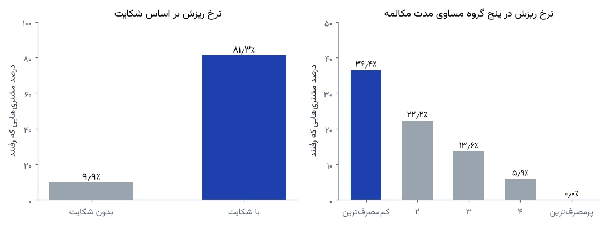
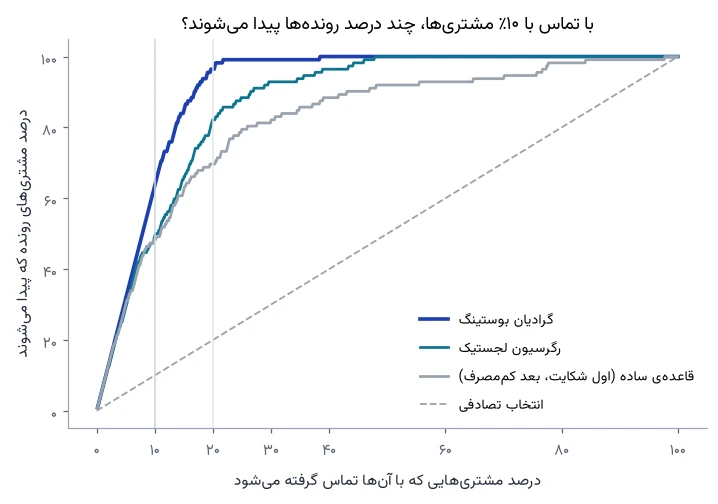
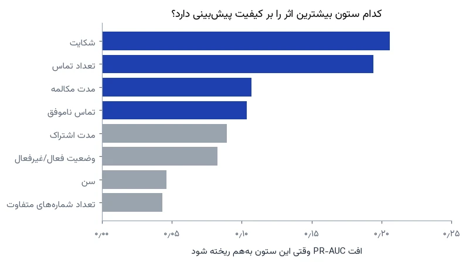

# کدام مشتری‌ها می‌روند؟ پیش‌بینی ریزش روی داده‌ی واقعی یک اپراتور ایرانی

هر کسب‌وکاری که مشترک دارد، یک روز این گزارش را می‌بیند: «این ماه فلان تعداد مشتری رفتند.» گزارش درست است، ولی دیر رسیده. مشتری رفته و دیگر برای نگه‌داشتنش کاری از دست کسی برنمی‌آید.

سؤال مفیدتر این است: **اگر امروز فقط بودجه‌ی تماس با ۱۰٪ مشتری‌ها را داشته باشیم، با کدام‌ها تماس بگیریم تا بیشترین رونده‌ها را قبل از رفتن پیدا کنیم؟**

این سؤال را روی داده‌ی واقعی یک اپراتور مخابراتی ایرانی جواب دادیم. همه‌ی کد، داده و نمودارها عمومی است و هر عدد این متن از خروجی همان کد آمده است.

## داده: ۹ ماه رفتار، برچسب در ماه دوازدهم

داده‌ی «Iranian Churn Dataset» به‌صورت تصادفی از پایگاه داده‌ی یک اپراتور مخابراتی ایرانی جمع شده و در مخزن یادگیری ماشین دانشگاه کالیفرنیا، ارواین (UCI) با مجوز CC BY 4.0 منتشر شده است. برای هر مشتری، رفتار ۹ ماه اول جمع زده شده و برچسب «رفت یا ماند» وضعیت او در پایان ماه دوازدهم است؛ سه ماه وسط فرصت برنامه‌ریزی است. این شبیه وضعیت یک مدیر است: گذشته را می‌بیند و باید آینده را حدس بزند.

ستون‌ها چیزهایی است که هر اپراتور، بانک یا فروشگاه اشتراکی در سیستمش دارد: تعداد تماس‌های ناموفق، اینکه مشتری شکایت ثبت کرده یا نه، مدت اشتراک، سطح شارژ، مدت و تعداد تماس، تعداد پیامک، تعداد شماره‌های متفاوتی که با آن‌ها تماس گرفته، سن و گروه سنی، نوع تعرفه، وضعیت فعال یا غیرفعال، و «ارزش مشتری» که خود اپراتور از روی مصرف حساب کرده است.

**اولین یافته قبل از هر مدلی:** ۳۰۰ ردیف از ۳٬۱۵۰ ردیف کاملاً تکراری بودند. داده شناسه‌ی مشتری ندارد، پس نمی‌دانیم این‌ها یک مشتری‌اند که دو بار ثبت شده یا دو مشتری با رفتار دقیقاً یکسان. در هر دو حالت، اگر قبل از جدا کردن داده‌ی آموزش و آزمون حذف نشوند، ممکن است مدل روی آزمون ردیفی را ببیند که عیناً در آموزش دیده و نمره‌اش بهتر از واقعیت به نظر برسد. بعد از حذف، ۲٬۸۵۰ مشترک ماند که ۱۵٫۶٪ آن‌ها رفته بودند. (آخر متن نشان می‌دهیم اگر این ردیف‌ها می‌ماندند، چه می‌شد.)

این داده را به دو بخش جدا کردیم: ۲٬۱۳۷ مشتری برای ساختن و انتخاب مدل، و ۷۱۳ مشتری (شامل ۱۱۲ رونده) که تا آخر کار کنار ماندند و مدل هیچ‌وقت آن‌ها را ندید. عددهای جدول اصلی روی همین ۷۱۳ نفر است؛ آزمون‌های پایداری، جلوتر، روی ۲۰ تقسیم دیگر انجام شده است.

## رونده‌ها چه شکلی‌اند؟

قبل از مدل، داده را نگاه کردیم (فقط بخش آموزش، تا داده‌ی آزمون دست‌نخورده بماند). سه الگو از بقیه پررنگ‌تر بود.

**شکایت.** از مشتری‌هایی که شکایت ثبت کرده بودند، ۸۱٫۳٪ رفتند و از بقیه ۹٫۹٪؛ یعنی نرخ ریزش در شکایت‌کننده‌ها حدود ۸ برابر بقیه بود. ولی طرف دیگر ماجرا هم مهم است: فقط ۴۱٫۶٪ رونده‌ها شکایت کرده بودند. بیش از نیمی از کسانی که رفتند، هیچ‌وقت شکایتی ثبت نکردند. پس شکایت نشانه‌ی قوی‌ای است، ولی فهرستی که فقط از شکایت‌ها ساخته شود، بیشتر رونده‌ها را نمی‌بیند.

**مصرف.** مشتری‌ها را بر اساس مدت مکالمه‌ی ۹ ماه به پنج گروه مساوی تقسیم کردیم. در کم‌مصرف‌ترین گروه، ۳۶٫۴٪ رفتند؛ در پرمصرف‌ترین گروه، هیچ‌کس. این داده فقط جمع ۹ ماه را دارد، نه روند ماه‌به‌ماه را؛ پس نمی‌توانیم بگوییم مصرف این مشتری‌ها کم‌کم افت کرده بود. فقط می‌دانیم کم‌مصرف‌ها خیلی بیشتر رفتند.

**وضعیت غیرفعال.** ۴۷٫۶٪ مشتری‌های غیرفعال رفتند، در برابر ۵٫۶٪ فعال‌ها، و ۷۲٫۸٪ رونده‌ها در زمان ثبت داده غیرفعال بودند. این ستون را جلوتر جدا بررسی می‌کنیم، چون ممکن است به‌جای پیش‌بینی، رفتنی را نشان دهد که عملاً اتفاق افتاده.

## سه روش، یک داور

برای اینکه بدانیم مدل واقعاً چیزی اضافه می‌کند، سه روش را کنار هم گذاشتیم و هر سه را با یک معیار سنجیدیم:

1. **انتخاب تصادفی:** همان کاری که بدون هیچ تحلیلی انجام می‌شود.
2. **قاعده‌ی ساده:** چیزی که یک مدیر بدون مدل می‌نویسد، به ترتیب اولویت: اول کسانی که شکایت کرده‌اند و کم‌مصرف‌اند، بعد بقیه‌ی شکایت‌کننده‌ها، بعد کم‌مصرف‌ها. «کم‌مصرف» یعنی پایین‌ترین یک‌پنجم مدت مکالمه در داده‌ی آموزش. داخل هر گروه، ترتیب تصادفی است.
3. **دو مدل یادگیری ماشین:** رگرسیون لجستیک (ساده و قابل‌توضیح) و گرادیان بوستینگ (مدلی که الگوهای غیرخطی را می‌گیرد).

فرق این دو مدل این است که رگرسیون لجستیک هر ستون را جدا وزن می‌دهد: «شکایت این‌قدر خطر را بالا می‌برد، هر دقیقه مکالمه این‌قدر پایین.» گرادیان بوستینگ ترکیب ستون‌ها را هم می‌بیند. مثلاً می‌تواند یاد بگیرد که شکایتِ یک مشتری پرمصرف معنای متفاوتی با شکایتِ یک مشتری کم‌مصرف دارد. در اعتبارسنجی پنج‌بخشی روی ۲٬۱۳۷ مشتری آموزش، گرادیان بوستینگ امتیاز PR-AUC برابر ۰٫۹۴ گرفت و رگرسیون لجستیک ۰٫۷۴۷. بعد هر دو را فقط یک بار، در پایان، روی ۷۱۳ مشتری کنارگذاشته سنجیدیم.

PR-AUC یک عدد بین صفر و یک است که می‌گوید مدل در کل فهرست، رونده‌ها را چقدر خوب بالای فهرست می‌نشاند؛ برای انتخاب تصادفی برابر سهم رونده‌هاست و برای مدل بی‌نقص یک.

معیار اصلی ولی همان سؤال کسب‌وکاری است: **اگر با ۱۰٪ مشتری‌ها (۷۱ نفر از ۷۱۳ نفر) تماس بگیریم، چند رونده پیدا می‌شود؟** معیار «دقت» (درصد پیش‌بینی‌های درست) را عمداً کنار گذاشتیم: وقتی حدود ۱۶٪ مشتری‌ها می‌روند، مدلی که بگوید «هیچ‌کس نمی‌رود» دقتی حدود ۸۴٪ دارد و هیچ فایده‌ای ندارد.

## نتیجه

| روش | از ۷۱ تماس، چند رونده | درصد تماس‌های درست | سهم رونده‌های پیداشده | چند برابر تصادفی |
|-----|----------------------|--------------------|---------------------|------------------|
| انتخاب تصادفی | حدود ۱۱ | ۱۵٫۷٪ | ۱۰٪ | ۱ |
| قاعده‌ی ساده | ۵۴ | ۷۶٫۱٪ | ۴۸٫۲٪ | ۴٫۸ |
| رگرسیون لجستیک | ۵۵ | ۷۷٫۵٪ | ۴۹٫۱٪ | ۴٫۹ |
| گرادیان بوستینگ | ۷۱ | ۱۰۰٪ | ۶۳٫۴٪ | ۶٫۴ |

سه نکته از این جدول:

**یک قاعده‌ی خوب، هم‌اندازه‌ی یک مدل ساده است.** قاعده‌ای که فقط دو ستون را نگاه می‌کند و شکایت را اول می‌گذارد، از ۷۱ تماس ۵۴ رونده پیدا کرد؛ تقریباً ۵ برابر تماس تصادفی و فقط یک نفر کمتر از رگرسیون لجستیک. اگر امروز هیچ تحلیلی ندارید، از همین قاعده شروع کنید. ترتیب هم مهم است: همین دو شرط ۱۷۷ نفر را علامت می‌زنند، بیشتر از بودجه‌ی ۷۱ تماس. اگر ۷۱ نفر را بی‌ترتیب از بین آن‌ها انتخاب کنیم، فقط ۳۸ رونده پیدا می‌شود.

**گرادیان بوستینگ ۱۷ رونده‌ی دیگر پیدا کرد.** با همان ۷۱ تماس، ۷۱ رونده؛ هیچ تماسی هدر نرفت. این برتری از ترکیب ستون‌ها می‌آید، چیزی که یک قاعده‌ی دستی یا مدل خطی نمی‌بیند.

**سقف کار، بودجه است نه مدل.** ۱۱۲ رونده داریم و فقط ۷۱ تماس. حتی مدل بی‌نقص هم با این بودجه بیش از ۶۳٫۴٪ رونده‌ها را پیدا نمی‌کند، و گرادیان بوستینگ دقیقاً به همین سقف رسید. پس سؤال بعدی برای مدیر این نیست که «مدل بهتر بسازیم»؛ این است که «تماس بیشتر می‌ارزد یا نه». منحنی بالا جواب را نشان می‌دهد: با تماس با ۱۵٪ مشتری‌ها، گرادیان بوستینگ ۸۴٫۸٪ رونده‌ها را پیدا می‌کند و با ۲۰٪، ۹۶٫۴٪. قاعده‌ی ساده با همان ۲۰٪ تماس به ۶۹٫۶٪ می‌رسد. هرچه بودجه بزرگ‌تر شود، فاصله‌ی مدل و قاعده بیشتر می‌شود.

## نتیجه‌ی خیلی خوب، یعنی باید بیشتر شک کرد

صد درصد تماس درست، عددی است که در کار واقعی به‌ندرت دیده می‌شود. پس قبل از باور کردنش دو آزمون گذاشتیم.

**آزمون اول: آیا یک تقسیم خوش‌شانس بوده؟** ارزیابی گرادیان بوستینگ را با ۲۰ تقسیم تصادفی متفاوت آموزش و آزمون تکرار کردیم. میانگین «درصد تماس‌های درست» ۹۸٫۰٪ بود با انحراف معیار ۱٫۷. پس نتیجه به یک تقسیم خاص وابسته نیست.

**آزمون دوم: آیا مدل به ستونی تکیه می‌کند که جواب را لو می‌دهد؟** ستون «وضعیت غیرفعال» مشکوک است: مشتری‌ای که در ۹ ماه اول غیرفعال شده، شاید عملاً رفته باشد. «ارزش مشتری» هم از همان مصرف ساخته شده و اطلاعات تازه‌ای ندارد. این دو را حذف کردیم و دوباره ۲۰ بار سنجیدیم: ۹۶٫۹٪، با انحراف معیار ۱٫۹. حتی بدون این دو ستون، نتیجه تقریباً همان ماند. این کامل خیالمان را راحت نمی‌کند: مدت و تعداد تماس هنوز در مدل‌اند و مشتری‌ای که اصلاً تماس نگرفته، همان مشتری غیرفعال است. ولی نشان می‌دهد نتیجه به یک ستون خاص بند نیست.

نمودار بالا نشان می‌دهد هر ستون چقدر در کیفیت مدل اثر دارد: وقتی مقدارهای ستون «شکایت» را بین مشتری‌ها به‌هم می‌ریزیم، PR-AUC مدل ۰٫۲۱ افت می‌کند؛ برای «تعداد تماس» ۰٫۱۹، «مدت مکالمه» ۰٫۱۱ و «تماس‌های ناموفق» ۰٫۱۰. ستون‌هایی که به هم شبیه‌اند (مثل مدت و تعداد تماس) این اثر را بین خودشان تقسیم می‌کنند، پس این عددها را باید ترتیب تقریبی دانست، نه وزن دقیق.

## اگر ردیف‌های تکراری را حذف نمی‌کردیم

این آزمایش را عمداً انجام دادیم، چون خطای رایجی است. همان ارزیابی ۲۰ تقسیمی را روی داده‌ی خام، با ۳۰۰ ردیف تکراری، تکرار کردیم. به‌طور میانگین ۱۰۵ ردیف از ۷۸۸ ردیف آزمون (حدود ۱۳٪) یک نسخه‌ی کاملاً یکسان در داده‌ی آموزش داشتند.

در این داده نمره تقریباً عوض نشد: PR-AUC با تکراری‌ها ۰٫۹۵۲ بود و بدون آن‌ها ۰٫۹۵۱، که در محدوده‌ی نوسان عادی بین تقسیم‌هاست. حدس ما این است که دلیلش جدا بودن شدید رونده‌ها از مشتری‌هایی است که ماندند؛ مدل برای پیدا کردن رونده‌ها به حفظ کردن ردیف‌ها نیاز نداشت. ولی این را فقط چون سنجیدیم می‌دانیم. در داده‌ای که مرز رونده و ماننده محوتر است، همین ۱۳٪ هم‌پوشانی می‌تواند نمره‌ای بسازد که در استفاده‌ی واقعی تکرار نشود. حذف تکراری‌ها قبل از تقسیم، یک خط کد است و ارزش ریسک ندارد.

## این برای کسب‌وکار شما یعنی چه؟

اگر مشترک دارید (اپراتور، بانک، بیمه، باشگاه، نرم‌افزار اشتراکی، فروشگاه با مشتری تکراری)، این سه کار را می‌شود همین ماه شروع کرد:

1. **قاعده‌ی ساده را با ترتیب درست اجرا کنید.** در این داده، از شکایت‌کننده‌ها ۸۱٪ رفتند. فهرست هفتگی‌ای که اول شکایت‌کننده‌های کم‌مصرف، بعد بقیه‌ی شکایت‌کننده‌ها و بعد کم‌مصرف‌ها را نشان دهد، به مدل نیاز ندارد و در این داده هم‌اندازه‌ی رگرسیون لجستیک کار کرد.
2. **یادتان باشد بیشتر رونده‌ها شکایت نمی‌کنند.** بیش از نیمی از رونده‌ها هیچ شکایتی نداشتند. برای پیدا کردن آن‌ها باید رفتار را دید: مصرف، تماس‌های ناموفق، مدت اشتراک. اینجاست که مدل یادگیری ماشین از قاعده جلو می‌زند. اگر داده‌ی ماه‌به‌ماه دارید، مقایسه‌ی مصرف هر مشتری با ماه‌های قبل خودش ایده‌ی خوبی برای آزمودن است؛ این داده چنین ستونی نداشت و ما آن را نسنجیدیم.
3. **بودجه‌ی نگه‌داشت را با منحنی پوشش تعیین کنید، نه با حدس.** منحنی پوشش می‌گوید با تماس با چند درصد مشتری‌ها، چند درصد رونده‌ها پیدا می‌شوند. هزینه‌ی هر تماس و ارزش هر مشتری نگه‌داشته‌شده را کنار آن بگذارید تا معلوم شود تا کجا تماس گرفتن سود دارد.

برای محاسبه‌ی سود هر کمپین، این فرمول کافی است: (تعداد رونده‌های پیداشده × درصدی که با پیشنهاد می‌مانند × ارزش یک مشتری) منهای (تعداد تماس × هزینه‌ی هر تماس و پیشنهاد). عددهای خود کسب‌وکارتان را جای این‌ها بگذارید؛ ما برای این داده عددی نساختیم، چون هزینه‌ی تماس و ارزش مشتری این اپراتور را نداریم.

## روی داده‌ی خودتان از کجا شروع کنید؟

لازم نیست داده‌تان شبیه این اپراتور باشد. چهار قدم:

1. **پنجره‌ی زمانی را مشخص کنید.** مثلاً رفتار شش ماه گذشته‌ی هر مشتری، و برچسب «در سه ماه بعد رفت یا نه». مهم این است که هیچ اطلاعاتی از بعد از تاریخ پیش‌بینی وارد ستون‌ها نشود.
2. **ستون‌های رفتاری بسازید.** تعداد خرید یا تماس، مبلغ، فاصله از آخرین خرید، تعداد شکایت و تیکت پشتیبانی، تأخیر در پرداخت، و تغییر هر کدام نسبت به دوره‌ی قبل. بیشتر این‌ها در نرم‌افزار حسابداری یا CRM شما هست.
3. **اول قاعده‌ی ساده را بسنجید.** همان «اول شکایت، بعد افت مصرف». اگر قاعده‌ی ساده به اندازه‌ی کافی خوب است، مدل لازم نیست.
4. **مدل را روی ماه‌های آخر بسنجید، نه روی نمونه‌ی تصادفی.** مدل را با داده‌ی قدیمی‌تر بسازید و ببینید روی جدیدترین ماه‌ها چند رونده را درست پیدا می‌کند. این نزدیک‌ترین شبیه‌سازی به استفاده‌ی واقعی است.

## محدودیت‌ها

- **داده‌ی یک شرکت و یک دوره است.** رابطه‌ی شکایت و رفتن احتمالاً در کسب‌وکارهای دیگر هم دیده می‌شود، ولی اندازه‌ی اثرها فرق می‌کند. مدل را باید روی داده‌ی خود شما دوباره ساخت و سنجید.
- **این داده تمیزتر و جداشدنی‌تر از داده‌ی معمول سازمان‌هاست.** ستون‌ها کامل‌اند و رونده‌ها با چند ستون به‌خوبی از بقیه جدا می‌شوند. در عمل بیشتر وقت پروژه صرف جمع کردن و پاک‌سازی داده می‌شود و نتیجه‌ی نهایی معمولاً به این خوبی نیست. صد درصد این مقاله را سقف بدانید، نه انتظار.
- **زمان در داده نیست.** همه‌ی مشتری‌ها در یک بازه‌اند؛ نمی‌دانیم مدلی که امسال ساخته شود سال بعد هم همین‌قدر خوب کار می‌کند. در پروژه‌ی واقعی، مدل روی ماه‌های جدیدتر آزمایش و هر چند ماه دوباره ساخته می‌شود.
- **پیش‌بینی، علت نیست.** شکایت با رفتن همراه است؛ این ثابت نمی‌کند که حل کردن شکایت جلوی رفتن را می‌گیرد. برای فهمیدن اثر واقعی پیشنهاد نگه‌داشت، باید یک آزمایش کنترل‌شده انجام داد: به نیمی از رونده‌های پیش‌بینی‌شده پیشنهاد بدهید و به نیم دیگر نه.

## کد و داده

همه‌ی کار در یک نوت‌بوک پایتون است که از اول تا آخر بدون خطا اجرا می‌شود: [github.com/FarrokhML/homat-labs](https://github.com/FarrokhML/homat-labs/tree/main/iranian-telecom-churn). داده از [مخزن UCI](https://archive.ics.uci.edu/dataset/563/iranian+churn+dataset) است (DOI: 10.24432/C5JW3Z، مجوز CC BY 4.0). ابزارها: pandas، scikit-learn، matplotlib.

## اگر می‌خواهید همین را روی مشتری‌های خودتان ببینید

[پیش‌بینی ریزش مشتری و پیشنهاد اقدام](/solutions.php#product-churn-prediction) یکی از راهکارهای آماده‌ی هومات است: داده‌ی مشتری‌های شما، فهرست هفتگی کسانی که احتمال رفتنشان بالاست، و دلیل هر کدام. بررسی اولیه رایگان است: [درخواست تحلیل رایگان](/data-analysis.php#form).
